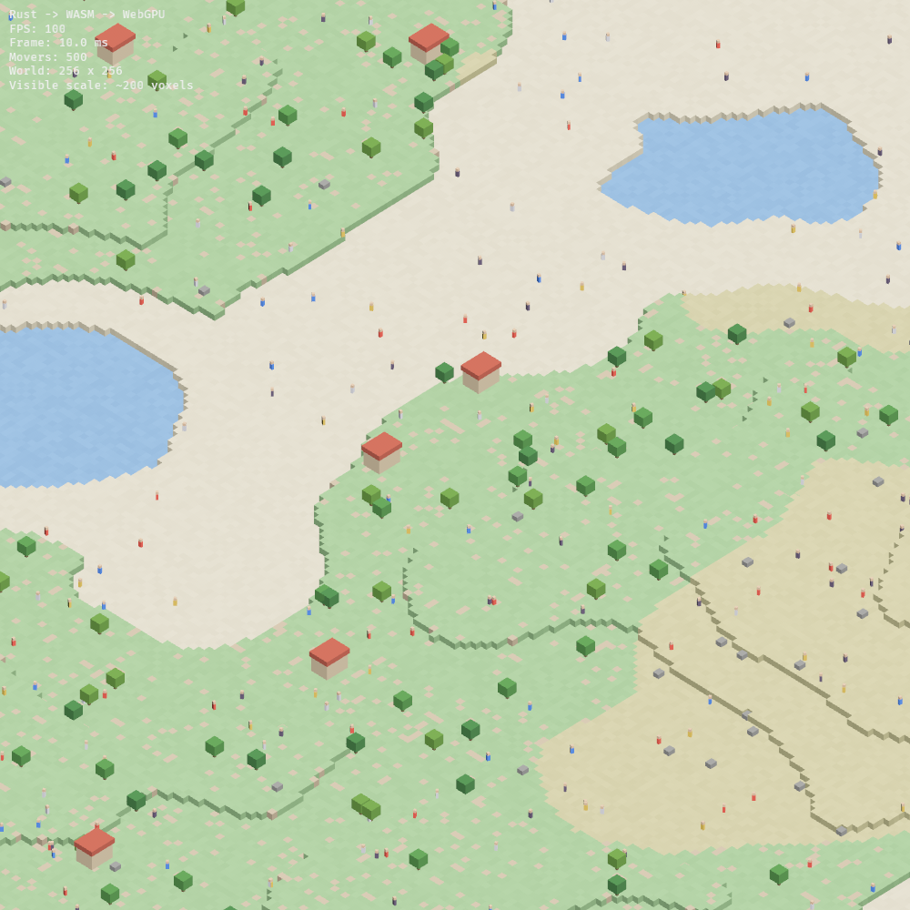

# Rust + WASM + WebGPU Voxel Demo

A small Rust/Bevy voxel simulation compiled to WebAssembly and rendered with
WebGPU in the browser. A fixed isometric-style orthographic camera frames a
256 × 256 procedural voxel world (~200 voxels visible) populated by 500 tiny
wandering "people", trees, rocks, and houses.



Built with **Bevy 0.19** targeting **wasm32-unknown-unknown** with Bevy's
**`webgpu`** feature (WebGPU, not WebGL2 — see `docs/WEB_BUILD.md`).

## Quick start (browser)

From a machine with Rust installed:

```bash
rustup target add wasm32-unknown-unknown
cargo install wasm-server-runner
./run-web.sh
```

Then open the printed URL — normally **http://127.0.0.1:1334**.

`./run-web.sh` is a thin wrapper around:

```bash
cargo run --target wasm32-unknown-unknown --features webgpu
```

(it also points wasm-server-runner at the custom page in `web/index.html`).

Requires a browser with WebGPU enabled (current Chrome/Edge; Safari/Firefox
with WebGPU support).

## Native run

```bash
cargo run
```

Opens the same scene as a native desktop window. Game logic is identical; only
the graphics backend differs (Metal/Vulkan/DX12 natively).

## Release build (web)

```bash
cargo build --release --target wasm32-unknown-unknown --features webgpu
```

The release profile uses `opt-level = "s"`, LTO, and one codegen unit for a
smaller .wasm.

## Iteration speed

The dev profile is tuned for the edit-refresh loop (no debuginfo/symbols,
deps at `opt-level = "s"`): a one-line change takes roughly **1–2 s to
compile** and **~10 s total** until the browser is rendering the new build
(wasm-bindgen + server restart + loading a ~51 MB dev wasm). If you need
debugger-friendly builds, set `debug = true` and remove `strip` in
`[profile.dev]` (Cargo.toml) — the dev wasm grows to ~130 MB.

## Tuning

Everything interesting lives in [`src/config.rs`](src/config.rs):

- world size — `WORLD_WIDTH`, `WORLD_DEPTH`
- terrain scale — `TERRAIN_MAX_HEIGHT`, `WATER_LEVEL`, `TERRAIN_CHUNK_SIZE`
- camera framing — `TARGET_VISIBLE_VOXELS`, `CAMERA_AZIMUTH_DEGREES`, `CAMERA_ELEVATION_DEGREES`
- mover count — `MOVER_COUNT` (try 100 / 500 / 1000 / 2000 / 5000)
- movement speed — `MOVER_MIN_SPEED`, `MOVER_MAX_SPEED`
- seed — `WORLD_SEED` (deterministic; same seed = same map)

See [`docs/TUNING.md`](docs/TUNING.md) for details.

## Architecture

`main.rs` composes five plugins — world data, terrain meshing, movers, camera,
diagnostics overlay — each in its own module. Terrain is meshed in 16 × 16
chunks (top faces + exposed side faces only, per-vertex colors, one shared
material). See [`docs/ARCHITECTURE.md`](docs/ARCHITECTURE.md).

## Browser notes

This demo intentionally requires **WebGPU**. If `navigator.gpu` is missing the
page shows a fallback message instead of the demo. Do not switch it to WebGL2
— demonstrating the Rust → WASM → WebGPU path is the point of the project.

## Performance

Default workload:

```text
256 × 256 terrain (256 chunk meshes, hidden faces culled)
~200 × 200 voxel visible footprint
500 moving entities (shared meshes/materials)
~300 static decorations
```

An FPS/frame-time overlay renders in the top-left corner.
