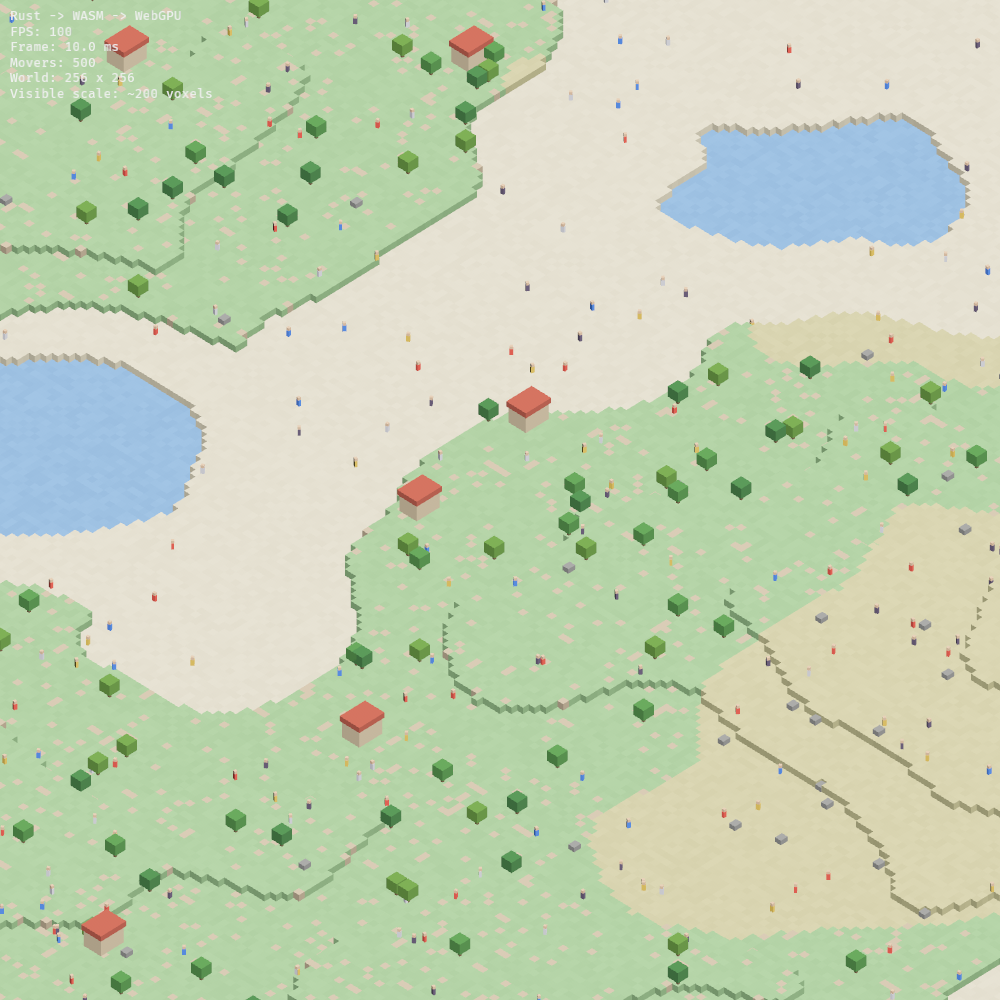

# Agent Implementation Plan: Rust + WASM + WebGPU Voxel Browser Demo

## Mission

Starting from an **empty folder**, build a polished, self-contained browser demo proving that a 3D voxel-style game can be written in **Rust**, compiled to **WebAssembly (WASM)**, and rendered in the browser using **WebGPU**.

The demo is not intended to be a full game. It is a technical/art-direction prototype that should immediately communicate:

- Rust game code is running in the browser.
- The scene is rendered as real 3D.
- The visual scale is appropriate for a zoomed-out voxel strategy/simulation game.
- Roughly **200 × 200 world voxels** are visible at once.
- The camera is fixed at an isometric-like 45° viewing angle.
- Terrain has enough height and color variation that individual voxel-scale cells are visually legible.
- Hundreds of small moving objects make the world feel alive.
- The project is well documented so another coding agent can modify it without reverse-engineering the codebase.

Do not over-engineer this. Prioritize a demo that is visually convincing, easy to run, easy to modify, and easy to understand.

---

# 1. Required Technical Stack

Use:

- **Rust**
- **Bevy 0.19**
- **WebAssembly target:** `wasm32-unknown-unknown`
- **Browser renderer:** WebGPU
- Bevy's `webgpu` feature for WASM
- Vanilla HTML/CSS only for the surrounding page
- No React, Vue, TypeScript, npm application framework, or other web framework unless absolutely required by the build tooling
- Keep game logic in Rust

The demo should also remain capable of compiling as a normal native Bevy application where practical, even though the primary acceptance target is the browser.

Do not build directly against raw `wgpu` unless Bevy proves unable to satisfy a requirement.

---

# 2. First-Time Environment Setup

The agent must detect missing dependencies where possible and print clear instructions rather than silently failing.

Expected prerequisites:

```bash
rustc --version
cargo --version
```

Install the WASM compilation target:

```bash
rustup target add wasm32-unknown-unknown
```

Use a simple local WASM development runner.

Preferred:

```bash
cargo install wasm-server-runner
```

Configure Cargo so running the WASM target automatically launches a local web server.

Create:

```text
.cargo/config.toml
```

with an appropriate runner configuration for `wasm32-unknown-unknown`.

If the exact current `wasm-server-runner` configuration differs, inspect its installed help/current documentation and use the supported configuration.

The final project must provide a single obvious development command, ideally:

```bash
cargo run --target wasm32-unknown-unknown --features webgpu
```

or a very small wrapper such as:

```bash
./run-web.sh
```

If browser launch cannot be made completely automatic, print the local URL clearly.

Also provide:

```bash
cargo run
```

for a native desktop run if that can be supported without compromising the web version.

---

# 3. Expected Repository Layout

Create approximately this structure:

```text
.
├── .cargo/
│   └── config.toml
├── assets/
│   └── README.md
├── docs/
│   ├── ARCHITECTURE.md
│   ├── TUNING.md
│   └── WEB_BUILD.md
├── src/
│   ├── main.rs
│   ├── camera.rs
│   ├── config.rs
│   ├── diagnostics.rs
│   ├── movers.rs
│   ├── terrain.rs
│   └── world.rs
├── .gitignore
├── AGENTS.md
├── Cargo.toml
├── README.md
└── run-web.sh
```

Exact filenames may vary slightly if there is a good reason, but preserve the separation of concerns.

---

# 4. Scene Specification

## World Dimensions

Generate a world at least:

```text
256 × 256 voxels
```

in X/Z.

One world unit should equal one voxel:

```text
1 voxel = 1.0 Bevy world unit
```

This makes reasoning about scale straightforward.

The camera should frame approximately:

```text
~200 × 200 voxels
```

at once.

The user described the target as approximately:

```text
1000 screen pixels / 200 voxels ~= 5 pixels per voxel
```

Do not obsess over exact pixel coverage because an angled 3D camera changes projected scale. Aim for the **visual impression** of roughly five pixels per ground voxel on a typical 1000px-high viewport.

The demo must adapt to browser resizing while maintaining roughly the same world framing rather than zooming dramatically.

---

# 5. Camera

Use an **orthographic** camera.

The camera must be fixed: no normal orbiting, panning, or zooming.

Use an isometric-style orientation:

```text
azimuth around world Y: 45°
elevation/downward pitch: approximately 35°–45°
```

Recommended starting position conceptually:

```text
camera target = center of world
camera direction = diagonal across X/Z
```

A mathematically classic isometric elevation of approximately 35.264° is acceptable and may look better than exactly 45° downward.

The important requirement is:

- world horizontal axes appear diagonal on screen
- camera faces the world from approximately a 45° horizontal rotation
- camera angle does not change during play

Optionally add developer-only keyboard controls behind a `debug_camera` flag, but they must be disabled by default.

---

# 6. Terrain

## Terrain Shape

Create procedural voxel-style terrain.

Do NOT create 65,536 separate cube entities for a 256 × 256 terrain if avoidable.

Instead:

- represent terrain internally as a grid of height/color data
- generate chunk meshes
- preserve blocky voxel geometry
- merge geometry into manageable chunks

Suggested chunk size:

```text
16 × 16
```

or:

```text
32 × 32
```

Generate gentle terrain height variation.

Example height range:

```text
0–8 voxels
```

The terrain should contain:

- mostly rolling land
- a few small hills
- shallow lower areas
- optional water or a river if easy
- enough height change to prove this is real 3D

Avoid noisy "Minecraft mountain" terrain. This should read like terrain appropriate to a city/strategy game viewed from far away.

## Terrain Generation

Use deterministic procedural generation.

Set a visible constant seed in `config.rs`, such as:

```rust
pub const WORLD_SEED: u64 = 12345;
```

Changing the seed should create a different map.

Use inexpensive value noise, layered sine functions, or a lightweight noise crate.

Do not add a large dependency solely for terrain if simple procedural math is sufficient.

---

# 7. Terrain Color Treatment

This is important.

The terrain must have **varying colors at voxel scale** so the viewer can visually understand the resolution of the voxel grid.

Do not make the entire ground one flat green material.

Each terrain cell/top face should receive a color based on some combination of:

- base biome/material
- height
- pseudo-random variation
- slope or local neighborhood

Example palette concept:

```text
grass dark
grass medium
grass light
dry grass
earth
rock
water
```

Use restrained variation rather than rainbow noise.

Neighboring voxels should often differ slightly.

The result should let the viewer look at the ground and think:

> "I can see roughly how large one voxel is."

If per-face vertex colors are convenient, use them.

Prefer a shared material + vertex colors or a small material palette rather than creating tens of thousands of unique materials.

Use nearest-looking/blocky aesthetics. Avoid texture filtering or detailed photographic textures.

---

# 8. Voxel Geometry

Terrain blocks should visibly read as square/cubic units.

Avoid smoothing terrain normals in a way that makes it look like continuous rolling terrain.

Use:

- flat faces
- hard edges
- flat or simple lighting

A small amount of ambient occlusion/shadowing is welcome if it works reliably in browser WebGPU, but visual clarity and performance are more important.

Do not add expensive visual features simply because WebGPU supports them.

---

# 9. Lighting

Use a simple lighting setup.

Recommended:

- ambient/world light
- one directional "sun" light
- soft shadows if performance remains good

Choose a sun direction that produces readable shadows from hills and moving objects.

The scene should look pleasant immediately rather than like an engine default.

Avoid:

- dramatic darkness
- heavy bloom
- excessive fog
- post-processing that obscures voxel edges

A subtle atmospheric background/clear color is fine.

---

# 10. Moving Objects

Populate the terrain with a large number of simple moving entities.

Target:

```text
500 moving entities initially
```

and expose the count as one easy-to-find configuration constant.

The architecture should comfortably permit testing:

```text
100
500
1,000
2,000
5,000
```

without rewriting the system.

## Appearance

Use very cheap placeholder shapes.

Possible "people":

```text
body = small rectangular prism
head = small cube
```

At this camera scale, an entity may only occupy a few pixels.

Alternatively use "cars":

```text
low rectangular body
smaller top block
```

A mixture is welcome but unnecessary.

Do not import external 3D models.

Use shared mesh handles.

Use a small reusable palette of materials/colors.

Do not create unique mesh assets or unique materials for every mover.

---

# 11. Mover Behavior

Movers should visibly move continuously.

They do not need sophisticated AI.

Implement deterministic simple wandering:

- each mover has position
- direction/velocity
- speed
- next direction-change timer
- optionally a target point

Movement rules:

1. Pick a random nearby target or heading.
2. Move across the terrain.
3. Periodically change direction.
4. Stay inside the world bounds.
5. Follow terrain height so objects sit on top of the ground.
6. Avoid entering water if water is implemented.
7. Turn to roughly face their travel direction if visible at this scale.

A subset may follow simple "roads" if roads are later added, but this is not required.

Movement should be smooth in real time even though the art style is voxelized.

Do not move them one voxel per discrete tick unless it looks better.

---

# 12. Performance-Conscious Design

This prototype is specifically meant to explore Rust/WASM/browser game viability, so basic performance hygiene matters.

## Terrain

Do not represent every terrain voxel as a separate Bevy entity.

Use chunked meshes.

Recommended:

```text
256 × 256 world
16 × 16 chunks
= 16 × 16 = 256 terrain chunks
```

Fewer chunks are acceptable if beneficial.

Do not generate hidden internal cube faces.

For each terrain cell, generate:

- top face
- side faces only where adjacent terrain is lower

This should dramatically reduce geometry compared with independent cubes.

## Movers

Initially, individual mover entities are acceptable.

However:

- reuse meshes
- reuse materials
- avoid allocations in the per-frame movement loop
- avoid spawning/despawning continuously
- query only components needed by each system

If rendering thousands of movers becomes the bottleneck, investigate instancing as an optional later optimization, but do not let custom instancing delay the first working demo.

---

# 13. Diagnostics Overlay

Add a small unobtrusive debug/performance overlay in a screen corner.

Display at least:

```text
Rust + WASM + WebGPU
FPS: xx
Frame: xx.x ms
Movers: 500
World: 256 x 256
Visible scale: ~200 voxels
```

If browser backend information can be obtained reliably, display it.

The text should explicitly say:

```text
Rust → WASM → WebGPU
```

so the purpose of the demo is obvious in a screenshot.

If Bevy diagnostics make FPS unavailable for the first few frames, show `--` until data exists.

---

# 14. Browser Page

The browser experience should feel deliberate.

Requirements:

- canvas fills most/all browser viewport
- zero unnecessary scrollbars
- dark neutral page background
- centered canvas if it does not fill viewport
- game resizes with browser
- tiny loading/status text is acceptable
- no elaborate webpage chrome

The first visible result should be the game, not a developer page.

Add a short fallback message if WebGPU initialization fails:

```text
This demo requires a browser with WebGPU enabled.
Try a current version of Chrome, Edge, Firefox, or Safari with WebGPU support.
```

Do not claim support for a browser unless the implementation actually works there.

---

# 15. Configuration

Centralize demo tuning in:

```text
src/config.rs
```

Another agent should be able to alter the prototype without hunting through systems.

Include clearly named constants/resources such as:

```rust
pub const WORLD_WIDTH: usize = 256;
pub const WORLD_DEPTH: usize = 256;
pub const WORLD_SEED: u64 = 12345;

pub const TARGET_VISIBLE_VOXELS: f32 = 200.0;

pub const TERRAIN_MAX_HEIGHT: u32 = 8;
pub const TERRAIN_CHUNK_SIZE: usize = 16;

pub const MOVER_COUNT: usize = 500;
pub const MOVER_MIN_SPEED: f32 = 2.0;
pub const MOVER_MAX_SPEED: f32 = 6.0;

pub const CAMERA_AZIMUTH_DEGREES: f32 = 45.0;
pub const CAMERA_ELEVATION_DEGREES: f32 = 38.0;
```

Exact Rust representation can vary, but these concepts must be centralized.

---

# 16. Suggested Rust Architecture

Use Bevy plugins/modules to keep functionality isolated.

Approximate application setup:

```rust
App::new()
    .add_plugins(DefaultPlugins.set(...))
    .add_plugins(WorldPlugin)
    .add_plugins(TerrainPlugin)
    .add_plugins(MoversPlugin)
    .add_plugins(CameraPlugin)
    .add_plugins(DiagnosticsPlugin)
    .run();
```

Avoid a single 1,000-line `main.rs`.

`main.rs` should mostly configure and compose the app.

Suggested responsibilities:

## `config.rs`

All easy tuning parameters.

## `world.rs`

World dimensions, seed, generated map data, height lookup, terrain metadata.

## `terrain.rs`

Chunk mesh generation, colors, terrain spawning.

## `movers.rs`

Mover component definitions, spawning, movement, terrain-following.

## `camera.rs`

Orthographic camera setup and viewport-resize behavior.

## `diagnostics.rs`

FPS/frame-time/backend/demo information overlay.

---

# 17. Height Lookup API

Moving objects need an inexpensive way to determine ground height.

The world representation should provide something conceptually like:

```rust
fn terrain_height_at(&self, x: f32, z: f32) -> f32
```

or:

```rust
fn terrain_cell(&self, x: usize, z: usize) -> TerrainCell
```

Do not raycast the terrain every frame for every mover unless there is a compelling reason.

The terrain data already knows the cell height; use it directly.

---

# 18. Visual Polish Pass

After the basic prototype works, spend time making it look intentional.

Implement several of these inexpensive improvements:

- tasteful terrain palette
- subtle height-dependent color differences
- directional shadows
- a small river or lake
- a few clusters of static trees
- a few larger block structures
- roads or dirt paths
- movers with 3–5 color variants
- gentle sky/background color
- edge darkening through lighting rather than outlines

Do not spend time on complex shaders before core requirements are finished.

The final screenshot should look closer to a tiny stylized strategy game than a raw rendering test.

---

# 19. Optional Static World Objects

If time permits, add:

```text
100–300 static objects
```

such as:

- voxel trees
- rocks
- tiny houses
- crates
- simple towers

These should use shared meshes/materials.

Their purpose is to add visual scale cues.

Keep them simple.

Example tree:

```text
1 voxel trunk
2 × 2 × 2-ish block canopy
```

Example building:

```text
3 × 4 footprint
3–6 voxels tall
simple contrasting roof block
```

---

# 20. No Asset Dependency for MVP

The MVP must be procedurally generated.

The project should run after cloning/building without downloading game art.

No Blender.
No texture packs.
No model files.
No paid assets.

This ensures the demo remains an easy technical test.

---

# 21. Build Profiles

Configure Cargo for usable WASM output.

Use sensible release settings such as:

```toml
[profile.release]
opt-level = "s"
lto = true
codegen-units = 1
```

If this makes iteration too slow, document a separate web-dev workflow.

Do not prematurely optimize binary size at the expense of completing the demo.

A development build must be easy.

A release build command must also be documented.

---

# 22. Browser/WASM Constraints

Be conscious that browser WASM differs from native execution.

Avoid assumptions about:

- normal filesystem access
- blocking OS APIs
- native window APIs
- native threading unless explicitly configured for browser WASM

For this demo, none of those should be necessary.

Keep the prototype single-process and straightforward.

---

# 23. Error Handling

The app should fail clearly.

Useful failures:

- WebGPU unavailable
- WASM build target missing
- runner not installed
- Rust toolchain too old
- shader/render initialization problem

Error messages should say what the developer should do next.

Do not swallow browser-console errors.

---

# 24. README.md

Create an excellent root README.

It must include:

## What this is

One paragraph:

> A small Rust/Bevy voxel simulation compiled to WebAssembly and rendered with WebGPU in the browser.

## Screenshot

Leave a placeholder if the agent cannot automatically capture one:

```markdown

```

Only reference the screenshot once it actually exists.

## Quick start

From an empty machine with Rust installed:

```bash
rustup target add wasm32-unknown-unknown
cargo install wasm-server-runner
./run-web.sh
```

or the exact final commands chosen.

## Native run

```bash
cargo run
```

if supported.

## Important tuning parameters

Point to:

```text
src/config.rs
```

and list:

- world size
- terrain scale
- camera framing
- mover count
- movement speed
- seed

## Architecture

Short description plus pointer to:

```text
docs/ARCHITECTURE.md
```

## Browser notes

Explain WebGPU requirement.

## Performance

Document rough expected workload:

```text
256 × 256 terrain
~200 × 200 voxel visual footprint
500 moving entities
```

---

# 25. AGENTS.md — Critical Handoff File

Create `AGENTS.md` specifically for future coding agents.

This is mandatory.

It should begin with something like:

```markdown
# Instructions for Coding Agents

This repository is a Rust/Bevy browser voxel demo.

Before modifying anything:
1. Read README.md.
2. Read docs/ARCHITECTURE.md.
3. Read src/config.rs.
4. Preserve browser WASM support.
5. Run the verification commands before declaring work complete.
```

It must document:

- current Bevy version
- browser target
- WebGPU feature requirement
- project goal
- camera conventions
- coordinate conventions
- terrain representation
- chunking strategy
- mover architecture
- where configuration lives
- which files own which systems
- performance-sensitive decisions
- commands to run
- commands to test
- commands to build web
- commands to build native
- known browser limitations
- what NOT to casually refactor

Include a rule:

> Any agent making a meaningful architectural change must update `AGENTS.md` and `docs/ARCHITECTURE.md` in the same change.

Also require agents to update documentation when adding a new major subsystem.

---

# 26. docs/ARCHITECTURE.md

Explain the project as if a new engineer is joining.

Include:

1. app startup
2. plugin layout
3. coordinate system
4. world generation
5. terrain cell data
6. chunk mesh generation
7. terrain coloring
8. moving entity systems
9. camera/framing math
10. diagnostics
11. browser/WASM build path
12. native build path
13. performance considerations

Include at least one ASCII data-flow diagram.

Example:

```text
World seed
   |
   v
World grid ----------> mover height queries
   |
   v
Terrain chunk builder
   |
   v
Bevy Mesh assets
   |
   v
WebGPU renderer
   |
   v
Browser canvas
```

---

# 27. docs/TUNING.md

Make the demo easy to experiment with.

Document exactly how to change:

## More/fewer visible voxels

Change:

```text
TARGET_VISIBLE_VOXELS
```

Explain:

```text
smaller value = camera appears closer
larger value = camera appears farther away
```

## More movers

Change:

```text
MOVER_COUNT
```

Include suggested test values:

```text
100
500
1,000
2,000
5,000
```

## Terrain roughness

Identify exact constants/functions.

## Terrain colors

Identify palette location.

## Camera angle

Identify azimuth/elevation constants.

## World seed

Explain deterministic regeneration.

## World size

Warn about implications for terrain mesh generation.

---

# 28. docs/WEB_BUILD.md

Document the web toolchain in plain English:

```text
Rust source
    |
    v
rustc
target: wasm32-unknown-unknown
    |
    v
.wasm
    |
    v
browser
    |
    v
Bevy / wgpu
    |
    v
WebGPU
    |
    v
GPU
```

Explain that:

- Rust compiles into WebAssembly.
- WASM executes inside the browser.
- Bevy uses its rendering stack to target browser WebGPU.
- The webpage itself is only a host/shell.
- Most game/simulation logic remains Rust.

Also document the exact development and release commands.

---

# 29. Verification Commands

Before considering the task finished, run all applicable checks.

At minimum:

```bash
cargo fmt --check
cargo check
cargo check --target wasm32-unknown-unknown --features webgpu
```

Also run:

```bash
cargo clippy --all-targets --all-features -- -D warnings
```

if practical.

If platform-specific feature combinations make `--all-features` inappropriate, use the correct native and web feature sets separately and document why.

Then actually launch the browser build and verify it visually.

Do not treat "it compiles" as sufficient.

---

# 30. Browser Acceptance Testing

Open the page in a current WebGPU-capable browser.

Verify:

- browser page loads
- no fatal console errors
- WASM initializes
- WebGPU initializes
- terrain appears
- terrain is visibly voxelized
- terrain colors vary by cell/area
- scene contains elevation changes
- roughly 200 voxel cells span the visible world scale
- camera is fixed
- camera is approximately 45° around the world
- hundreds of objects are visible
- objects move
- objects stay on terrain
- FPS overlay updates
- resizing the browser does not break framing
- no obvious runaway memory growth during a short normal test
- demo continues running after several minutes

If possible, test at:

```text
1920 × 1080
1440 × 900
1000 × 1000
```

The exact viewport does not matter; the world scale should remain broadly consistent.

---

# 31. Visual Acceptance Criteria

The final scene should roughly communicate this:

```text
                 fixed orthographic camera
                        /
                       /
              45° --> /
                     /
        +---------------------------+
       /  . . trees . .    hill    /|
      / . . . . . . . . . . . .  / |
     +---------------------------+  |
     |   tiny people/cars moving |  |
     |   across voxel terrain    |  |
     |                           | /
     +---------------------------+
```

When viewed at normal size:

- a person/car should be only a handful of pixels
- an individual terrain voxel should be visible but small
- the world should dominate the image
- it should feel like the beginning of a strategy/simulation game
- it should NOT feel like a close-up Minecraft clone

---

# 32. Approximate Camera Calibration

Do not hard-code camera scale blindly.

Implement a named function such as:

```rust
fn configure_camera_for_visible_voxels(
    projection: &mut OrthographicProjection,
    target_visible_voxels: f32,
    viewport_aspect: f32,
)
```

or equivalent.

Use `TARGET_VISIBLE_VOXELS ~= 200.0` as the central art-direction parameter.

Because of orthographic projection and the diagonal view, exact visible world dimensions depend on the camera basis.

Tune visually at a 1000px-high square viewport.

Goal:

```text
~200 voxel-scale cells across approximately 1000 screen pixels
```

which yields approximately:

```text
~5 px per voxel
```

Do not attempt fake screen-space pixel-perfect rendering.

This is an approximate scale target.

---

# 33. Terrain Mesh Algorithm

A straightforward acceptable implementation:

For each terrain chunk:

1. Iterate over its X/Z cells.
2. Get integer height `h`.
3. Emit one top quad at `y = h`.
4. Compare `h` to north/south/east/west neighbor heights.
5. For any lower neighbor, emit vertical side faces from neighbor height to `h`.
6. Assign per-vertex or per-face color.
7. Add positions.
8. Add normals.
9. Add indices.
10. Construct one Bevy `Mesh` for that chunk.

Do not generate bottom faces.

Do not generate internal side faces between equal-height cells.

This keeps the voxel appearance while greatly reducing geometry.

---

# 34. Terrain Data Structure

Use a compact CPU representation.

For example:

```rust
pub struct TerrainCell {
    pub height: u8,
    pub terrain_type: TerrainType,
    pub color_variant: u8,
}
```

World storage could be:

```rust
Vec<TerrainCell>
```

with:

```rust
index = z * WORLD_WIDTH + x
```

This is preferable to a deeply nested collection.

Expose safe helper methods for indexing and bounds.

---

# 35. Deterministic Randomness

Use seeded randomness.

Moving entity starting positions and terrain generation should be reproducible.

Use a lightweight deterministic RNG crate if necessary.

Put the seed in configuration.

This makes screenshots/debugging consistent across agents.

---

# 36. Mover Components

A simple ECS design is sufficient.

Conceptually:

```rust
#[derive(Component)]
struct Mover;

#[derive(Component)]
struct Velocity(Vec3);

#[derive(Component)]
struct WanderState {
    change_direction_in: f32,
}
```

Or equivalent.

Do not build a generalized AI framework.

Keep this demo inspectable.

---

# 37. Movement Update

Use delta time.

Conceptually:

```text
position += velocity * dt
```

After moving:

1. clamp/bounce/retarget at world edge
2. obtain terrain height from world grid
3. set mover Y to terrain surface + half mover height
4. occasionally update direction
5. rotate visual if needed

Do not allocate random generators or vectors repeatedly per entity per frame if easily avoidable.

---

# 38. Performance Experiment Controls

Add convenient keyboard shortcuts ONLY if they are trivial and do not complicate browser focus behavior.

Optional:

```text
1 = 100 movers
2 = 500 movers
3 = 1,000 movers
4 = 2,000 movers
5 = 5,000 movers
R = regenerate world with next seed
```

If implemented, display the shortcuts in a tiny help overlay.

However, configuration constants are sufficient for MVP.

Do not sacrifice reliability for controls.

---

# 39. Useful Diagnostic Metrics

If easy, add:

```text
FPS
frame time
entity count
mover count
terrain chunk count
```

Optional:

```text
triangle count
draw-call approximation
```

Do not build a profiling framework.

The goal is simply to make performance experiments easy.

---

# 40. WebGPU Compatibility Note

Bevy's WASM WebGPU path must be explicitly enabled using its `webgpu` feature.

Keep that decision documented in:

```text
Cargo.toml
README.md
AGENTS.md
docs/WEB_BUILD.md
```

Do not silently switch the primary demo to WebGL2.

A WebGL2 fallback can be investigated later, but this demo is specifically intended to demonstrate:

```text
Rust + WASM + WebGPU
```

---

# 41. Native Build

Where practical, structure the app so:

```bash
cargo run
```

opens the same scene as a native desktop application.

The native renderer may use the appropriate platform graphics backend automatically.

Do not introduce separate game logic for web and native.

Platform-specific code should be minimal and isolated.

---

# 42. Git Hygiene

Initialize git:

```bash
git init
```

Create `.gitignore` containing at least:

```text
/target
.DS_Store
```

and any generated web build artifacts that should not be committed.

Make sensible commits if agent tooling permits.

Suggested milestones:

```text
1. bootstrap Bevy app and web build
2. procedural voxel terrain
3. fixed orthographic camera
4. movers
5. diagnostics and polish
6. documentation
```

Do not require git history for acceptance if commit operations are unavailable.

---

# 43. Recommended Implementation Order

Follow this order.

## Phase 1 — Bootstrap

Create:

- Cargo project
- Bevy dependency
- browser/WASM target configuration
- WebGPU feature
- local runner
- empty 3D scene
- camera/light
- successful browser launch

**Stop and fix the build if browser rendering does not work.**

Do not build the rest against an untested WASM pipeline.

## Phase 2 — Flat voxel field

Render a simple:

```text
64 × 64
```

temporary colored voxel field.

Confirm:

- geometry
- color
- lighting
- camera angle
- WebGPU

Then replace with final terrain architecture.

## Phase 3 — World data

Implement:

- 256 × 256 grid
- deterministic terrain height
- terrain type/color variation

## Phase 4 — Chunk meshes

Implement optimized voxel surface meshes.

Confirm the full terrain loads smoothly.

## Phase 5 — Camera calibration

Tune orthographic scale until the visible area is approximately:

```text
200 × 200 voxels
```

at a roughly 1000px-high viewport.

## Phase 6 — Movers

Start with:

```text
10
```

then:

```text
100
```

then:

```text
500
```

Confirm terrain following and bounds.

## Phase 7 — Diagnostics

Add FPS/frame information and explicit:

```text
Rust → WASM → WebGPU
```

label.

## Phase 8 — Polish

Add inexpensive visual improvements.

## Phase 9 — Documentation

Write/update all handoff documentation.

## Phase 10 — Final verification

Run formatter/checks.
Launch browser build.
Inspect visually.
Fix warnings/errors.
Update documentation to match reality.

---

# 44. Definition of Done

Do not declare completion until all mandatory items below are true.

- [ ] Project starts from the supplied empty folder.
- [ ] Rust project builds.
- [ ] WASM target builds.
- [ ] Browser version launches locally.
- [ ] Browser renderer uses WebGPU.
- [ ] Game logic is primarily Rust.
- [ ] Scene is genuine 3D.
- [ ] Camera is orthographic.
- [ ] Camera is fixed.
- [ ] Horizontal camera angle is approximately 45°.
- [ ] World is at least 256 × 256 cells.
- [ ] Approximately 200 × 200 voxels are represented in the visible scale.
- [ ] Terrain has voxel/block geometry.
- [ ] Terrain has varied heights.
- [ ] Terrain coloring visibly communicates voxel scale.
- [ ] Terrain is not implemented as tens of thousands of separate cube entities.
- [ ] Approximately 500 moving placeholder entities are present by default.
- [ ] Movers visibly travel around the world.
- [ ] Movers follow terrain height.
- [ ] Meshes/materials are reused.
- [ ] FPS/frame diagnostics are visible.
- [ ] Overlay says `Rust → WASM → WebGPU`.
- [ ] Browser resize works.
- [ ] `src/config.rs` centralizes major tuning.
- [ ] `README.md` explains setup/run.
- [ ] `AGENTS.md` gives future-agent instructions.
- [ ] `docs/ARCHITECTURE.md` explains implementation.
- [ ] `docs/TUNING.md` explains how to modify the demo.
- [ ] `docs/WEB_BUILD.md` explains Rust → WASM → WebGPU pipeline.
- [ ] Formatting/check commands pass.
- [ ] Demo has been visually tested in a browser.
- [ ] Documentation matches the actual implementation.

---

# 45. Stretch Goals — Only After Definition of Done

If everything above works, consider these in order:

1. Small river crossing the terrain.
2. Simple bridges.
3. Tiny roads/path network.
4. Two mover types: people and carts/cars.
5. Static voxel buildings.
6. Performance hotkeys for entity counts.
7. Mouse picking that highlights the voxel under the cursor.
8. A small UI panel showing selected voxel coordinates.
9. Native screenshot capture.
10. Experimental instanced mover rendering for several thousand agents.

Do not start these until all mandatory requirements work.

---

# 46. Things the Agent Should Explicitly Avoid

Do not:

- switch the implementation to JavaScript/Three.js
- put core simulation logic in JavaScript
- build a custom engine before proving the prototype
- spawn a separate entity for every terrain cube
- create one material per terrain cell
- introduce a frontend framework
- add an external database
- add networking
- add multiplayer
- add physics middleware
- import complex 3D assets
- create procedural systems so abstract that the demo becomes difficult to modify
- spend substantial time reducing WASM binary size before the scene works
- implement free camera controls as the default
- optimize before measuring obvious problems
- declare success without launching the WASM build in a browser

---

# 47. Final Agent Response

When the coding agent finishes, its response should include:

```text
DONE
```

followed by:

1. the exact command to run the browser version
2. the local URL if applicable
3. the exact command to run native
4. the Bevy version used
5. confirmation that browser rendering is WebGPU
6. world dimensions
7. default mover count
8. approximate visible voxel scale
9. files future agents should read first
10. any remaining known issues

Also include a compact summary such as:

```text
Rust source
  -> wasm32-unknown-unknown
  -> WebAssembly
  -> Bevy/wgpu
  -> browser WebGPU
  -> GPU
```

Do not merely state that code was generated. Confirm which verification commands were actually run and which browser behavior was actually observed.
